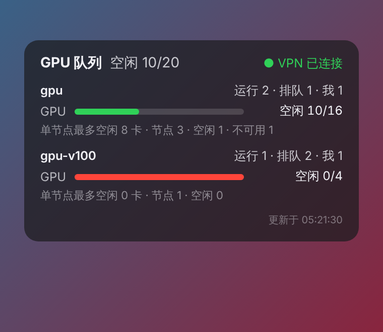

# macOS 集群队列桌面组件

[English](README.md) | **简体中文**

本项目为 macOS 桌面组件及菜单栏插件，用于显示 Slurm 集群各分区（队列）的占用情况。采集脚本首先检测 Tunnelblick VPN 的连接状态，必要时自动重连，随后经 SSH 查询集群，输出各分区的 GPU/CPU 利用率、作业数，并可选输出各节点状态。

<p align="center"></p>

## 功能

- **VPN 检测**：通过 AppleScript 读取指定 Tunnelblick 配置的状态；状态不为 `CONNECTED` 时发起连接，并在 `CONNECT_TIMEOUT` 秒内轮询。
- **单次 SSH 往返**：`scontrol show node -o` 与 `squeue` 在同一非交互会话（`BatchMode=yes`）中执行，并复用持久 SSH 连接（`ControlMaster`，`ControlPersist=300`），单次刷新耗时约 0.7–1.3 s。
- **按分区汇总**：GPU 已分配/总数（来源于 `Gres` 与 `AllocTRES`）、CPU 已分配/总数、空闲及不可用节点数、运行及排队作业数、当前用户的作业数。
- **MIG 识别**：由 MIG 切分 GPU（如 `gpu:2g.20gb:12`）构成的分区带有 `(MIG)` 标注，容量以 MIG 实例数而非物理卡数计。
- **可配置集群名**（`CLUSTER_NAME`），显示于组件标题与菜单栏。
- **内存与 GPU 型号**：按分区及节点显示主机内存占用（`RealMemory − FreeMem`），支持手动配置 GPU 型号标注（`GPU_MODELS`），并可选经 `nvidia-smi` 获取每张卡的型号、显存占用与利用率（`GPU_DETAIL=1`）。
- **当前用户的运行作业**（`SHOW_MY_JOBS=1`）：作业号、作业名、已运行时长/时限、节点，以及该作业所占每张卡的显存占用与利用率。
- **可选节点列表**（`SHOW_NODES=1`）：在每个分区下列出节点名、状态及单节点 GPU/CPU 占用（SwiftBar 中以子菜单呈现）。
- **双语界面**（`UI_LANG`）：两种前端均支持中文或英文标签，可显式指定或跟随 macOS 系统语言。
- **刷新机制**：两种前端的集群数据均每 15 s 刷新一次；作业已运行时长在本地每秒递增（Übersicht 组件定时器、SwiftBar 流式插件），不产生额外的集群查询。采集脚本以锁防止重叠运行，上一次运行未结束时直接返回上一次的结果。
- **桌面卡片可拖动**：按住 Übersicht 卡片标题即可拖动，位置在刷新后保持不变；双击标题恢复默认位置。
- 处于 `DOWN`、`DRAIN`、`FAIL`、`MAINT`、`NOT_RESPONDING` 状态的节点不计入可用容量；同属多个分区的节点在全局 GPU 总数中仅计一次。

## 显示方式

| 前端 | 位置 | 安装 |
|---|---|---|
| **Übersicht** | 桌面半透明卡片，每个分区一组进度条 | `brew install --cask ubersicht` |
| **SwiftBar** | 菜单栏项（如 `GPU 空闲 14/32`），下拉菜单显示各分区详情 | `brew install --cask swiftbar` |

两种前端调用同一采集脚本 `cluster-status.sh`，可任选其一或同时使用。

## 安装

1. 安装至少一种前端（见上表），并**启动一次**，以生成其插件目录。
2. 运行安装脚本并编辑生成的配置文件：

   ```bash
   git clone https://github.com/Yu-Xiang-Yang/slurm-gpu-widget.git
   cd slurm-gpu-widget
   bash install.sh
   open -e ~/.config/cluster-widget/config
   ```

3. 验证采集脚本；输出 JSON 即表明配置正确：

   ```bash
   ~/.config/cluster-widget/cluster-status.sh
   ~/.config/cluster-widget/cluster-status.sh --swiftbar
   ```

重复运行 `install.sh` 会更新脚本与组件，但不会覆盖已有的配置文件。

### 前提条件

1. **SSH 免密登录**。组件在后台运行，无法响应密码提示，须使用密钥认证；若密钥设有密码短语，应在 `~/.ssh/config` 中加入 `UseKeychain yes` 与 `AddKeysToAgent yes`。经跳板机访问时可使用 `ProxyJump`。
2. **VPN 无需交互**。Tunnelblick 凭据须保存于 macOS 钥匙串。需要动态验证码的 VPN 无法自动连接，此时建议设置 `AUTO_CONNECT=0`。
3. **自动化权限**。首次运行时 macOS 将询问是否允许 Übersicht/SwiftBar 控制 Tunnelblick，须予以允许，方可自动重连。

## 配置

配置文件：`~/.config/cluster-widget/config`（模板见 [`config.example`](config.example)）。命令行上给出的环境变量优先于配置文件。

| 键 | 默认值 | 说明 |
|---|---|---|
| `CLUSTER_NAME` | （空） | 显示于组件标题与菜单栏的集群名；为空时显示默认标题。 |
| `TB_CONFIG` | （空） | Tunnelblick 配置名；为空时不检测 VPN，直接 SSH。 |
| `SSH_HOST` | （空） | SSH 目标，建议使用 `~/.ssh/config` 中的 `Host` 别名。 |
| `AUTO_CONNECT` | `1` | VPN 未连接时是否自动发起 Tunnelblick 连接。 |
| `CONNECT_TIMEOUT` | `30` | 等待 VPN 连接的最长时间（s）。 |
| `SSH_TIMEOUT` | `8` | SSH 连接超时（s）。 |
| `PARTITIONS` | （空） | 以逗号分隔的分区白名单；为空时显示全部分区。 |
| `GPU_ONLY` | `1` | `1` 仅显示含 GPU 的分区；`0` 同时显示 CPU 分区及 CPU 进度条。 |
| `SHOW_NODES` | `0` | `1` 在每个分区下列出节点名、状态及单节点占用。 |
| `GPU_MODELS` | （空） | 各分区 GPU 型号标注，如 `gpu=NVIDIA A100 80GB;compute2=NVIDIA V100 32GB`；`Gres` 未写明型号时需手动填写。为空且 `GPU_DETAIL=1` 查询成功时，采用 `nvidia-smi` 报告的型号。 |
| `GPU_DETAIL` | `0` | `1` 在所显示分区的每个 GPU 节点上执行 `nvidia-smi`（由登录节点并行 SSH），逐卡列出型号、显存已用/总量及利用率。 |
| `GPU_DETAIL_TIMEOUT` | `6` | 单节点 `nvidia-smi` 查询超时（s）。 |
| `SHOW_MY_JOBS` | `1` | `1` 列出当前用户的运行作业，含已运行时长、时限、节点及逐卡显存/利用率（在作业分配内执行 `nvidia-smi`）。 |
| `JOB_GPU_INTERVAL` | `30` | 作业级 `nvidia-smi` 查询的最小间隔（s）；间隔内复用缓存，以限制组件创建的作业步数量。 |
| `UI_LANG` | `auto` | 界面语言：`zh`、`en` 或 `auto`（系统首选语言为中文时显示中文，否则显示英文）。 |

示例：不修改配置文件，临时查看全部分区及节点明细：

```bash
GPU_ONLY=0 SHOW_NODES=1 PARTITIONS=gpu,compute ~/.config/cluster-widget/cluster-status.sh --swiftbar
```

对于节点数较多（约 100 个）的分区，`SHOW_NODES=1` 宜与 `PARTITIONS` 配合使用，以限制卡片高度。

## 输出格式

`cluster-status.sh`（默认模式）输出一个 JSON 对象：

```json
{
  "lang": "zh", "cluster": "Demo", "show_nodes": true, "time": "13:58:32",
  "vpn": "CONNECTED", "error": "", "gpu_only": true,
  "gpu_used": 10, "gpu_total": 20,
  "partitions": [{
    "name": "gpu", "nodes": 3, "idle_nodes": 1, "down_nodes": 1,
    "cpu_used": 48, "cpu_total": 128, "gpu_used": 6, "gpu_total": 16,
    "gpu_max_free_node": 8, "running": 2, "pending": 1, "mine": 0, "mig": false,
    "model": "NVIDIA A100-SXM4-80GB", "mem_used": 1236992, "mem_total": 3072000,
    "node_list": [{"name": "gpu01", "state": "mixed", "cpu_used": 48, "cpu_total": 64, "gpu_used": 6, "gpu_total": 8,
                   "mem_used": 412000, "mem_total": 1024000,
                   "gpus": [{"index": 0, "name": "NVIDIA A100-SXM4-80GB", "mem_used": 61234, "mem_total": 81920, "util": 97}]}]
  }]
}
```

`SHOW_MY_JOBS=1` 时顶层对象另含 `"my_jobs": [{"id", "name", "partition", "elapsed", "limit", "nodes", "gres", "gpus": [{"index", "name", "mem_used", "mem_total", "util"}]}]`。`node_list` 仅在 `SHOW_NODES=1` 时出现；`gpus` 仅在 `GPU_DETAIL=1` 且节点接受查询时非空。内存单位为 MiB；由于不调度内存的集群中 `AllocMem` 恒为 0，主机内存占用按 `RealMemory − FreeMem` 计算。`gpu_max_free_node` 表示单个节点上空闲 GPU（或 MIG 实例）的最大数量，即可立即启动的单节点作业规模上限。

`--swiftbar` 输出 SwiftBar 插件格式；`--swiftbar-stream` 输出相同格式，但作业已运行时长以占位符（`@@EL:<elapsed_s>:<epoch>:<limit_s>@@`）表示，供流式插件每秒替换；`--connect` 仅触发 Tunnelblick 连接。`my_jobs` 中每个作业另含 `elapsed_s` 与 `limit_s`（`UNLIMITED` 记为 −1），顶层 `epoch` 记录采集时刻。

## 刷新间隔

| 组件 | 间隔 | 设置位置 |
|---|---|---|
| Übersicht 集群数据 | 15 s | `ubersicht/cluster-queue.widget/index.jsx` 顶部的 `REFRESH_SECONDS` |
| SwiftBar 集群数据 | 15 s | `swiftbar/cluster.sh` 中的 `REFRESH_SECONDS`（流式插件，文件名中不含间隔） |
| 作业已运行时长 | 1 s | 本地按 `elapsed_s + (now − epoch)` 计算，上限为 `limit_s` |
| 作业级 GPU 显存/利用率 | 30 s | 配置文件中的 `JOB_GPU_INTERVAL` |

## 无集群环境下的测试

仓库在 [`mock/`](mock) 中提供了合成的 `scontrol`/`squeue` 输出：

```bash
MOCK_DIR=mock bash cluster-status.sh
MOCK_DIR=mock SHOW_NODES=1 CLUSTER_NAME=Demo bash cluster-status.sh --swiftbar
```

## 实现原理

1. VPN 状态：`osascript -e 'tell application "Tunnelblick" to get state of first configuration where name = "…"'`。
2. 数据采集：`ssh -o BatchMode=yes $SSH_HOST "scontrol show node -o; squeue -h -o '%P|%T|%u'"`。
3. 可选 GPU 明细（`GPU_DETAIL=1`）：登录节点并行在各 GPU 节点上执行 `nvidia-smi --query-gpu=index,name,memory.used,memory.total,utilization.gpu`，单节点耗时受 `GPU_DETAIL_TIMEOUT` 限制。启用 `pam_slurm_adopt` 的集群仅允许登录用户有运行作业的节点，其余节点退回 Slurm 提供的数据。
4. 运行作业（`SHOW_MY_JOBS=1`）：`squeue -u $USER -t R` 提供作业号、作业名、已运行时长、时限与节点。对每个作业（至多 8 个）在其已有分配内执行 `srun --jobid=<id> --overlap -N1 -n1 nvidia-smi …`；在 `ConstrainDevices=yes` 的配置下仅可见该作业占用的 GPU，因此无需索引映射，也不申请额外资源。该方式不受 `pam_slurm_adopt` 限制。
5. 本地汇总（`awk`）：CPU 取 `CPUAlloc/CPUTot`；GPU 总数由 `Gres` 解析（兼容 `gpu:a100:8(S:0-1)`、`gpu:4`、`gpu:2g.20gb:12,gpu:1g.20gb:4` 等格式），已分配数取自 `AllocTRES` 中的 `gres/gpu=N`（为零时该项缺省）。`Partitions` 字段按逗号拆分，节点计入其所属的每个分区。

## 故障排查

| 现象 | 原因及处理 |
|---|---|
| `install.sh` 未提示安装任何前端 | 对应应用从未启动；启动一次后重新运行 `install.sh`。 |
| Übersicht 桌面无显示 | Übersicht 渲染服务（端口 41416）未启动；退出并重新打开 Übersicht 即可恢复，可用 `curl http://127.0.0.1:41416/` 验证。 |
| 显示 `ssh 失败` | 未配置密钥登录或主机别名有误；可用 `ssh -o BatchMode=yes $SSH_HOST true` 复现错误。 |
| VPN 始终未连接 | 凭据未存入钥匙串，或自动化权限被拒绝（系统设置 → 隐私与安全性 → 自动化）。 |

## 其他调度系统

`cluster-status.sh` 中仅远程命令与 `awk` 解析部分与调度系统相关（PBS：`pbsnodes -a` / `qstat`；LSF：`bhosts` / `bqueues`），JSON 格式与两种前端均无需改动。

## 许可证

[MIT](LICENSE)
